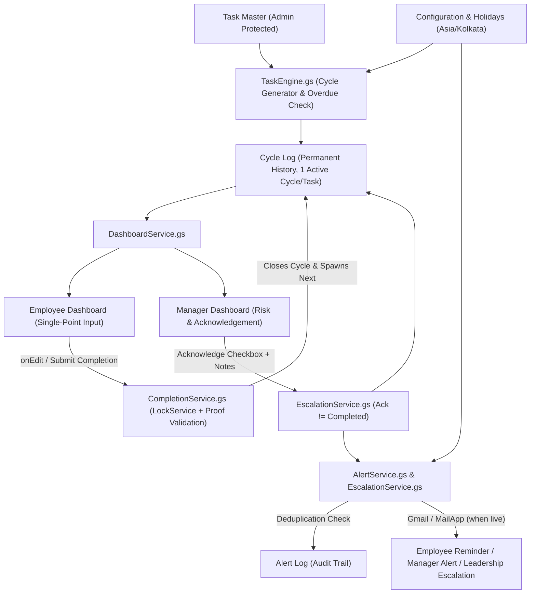

# Allo Innoware — Recurring Task Tracking, Pending Reports & Escalation Automation

A complete Google Sheets + Google Apps Script operational automation system built for **Allo Innoware (AI Operations / Founder's Office Assignment)**.

- **Live Working Google Sheet Prototype (Viewer Link):** https://docs.google.com/spreadsheets/d/1Mf-hqpqJVbA2J7xLcSBNEG7gpQ3qCavj-3qFD0uJurg/edit?usp=sharing

## Architecture Diagram



## Google Sheets Tabs
1. **`Employee Dashboard`** — Single-point employee workspace (`Ticket ID`, `Completion Confirmation` checkbox, optional WhatsApp `Proof Link`, `Completion Notes`, `Submission Action`).
2. **`Manager Dashboard`** — Centralized KPIs, employee-grouped summary, overdue watchlist, and Manager Acknowledgement controls.
3. **`Task Master`** — Recurring task definitions (`TASK-001`..`TASK-004`), recurrence modes (`Completion Based` / `Fixed Schedule`), and proof rules.
4. **`Cycle Log`** — Permanent non-destructive history of all cycles (`TASK-002-20261125-001`, etc.).
5. **`Alert Log`** — Deduplicated audit trail of all reminders, manager alerts, follow-ups, escalations, and resolution notices.
6. **`Configuration`** — Central SLA timings, placeholder emails, working days, holidays, and `Test Mode Enabled` / `Email Notifications Enabled` switches.
7. **`Test Results`** — Generated automatically by [`TestRunner.gs`](appsscript/TestRunner.gs).

## Project Structure
- [`appsscript/`](appsscript/) — Modular `clasp`-compatible Google Apps Script project (`Config.gs`, `Utils.gs`, `Setup.gs`, `TaskEngine.gs`, `CompletionService.gs`, `DashboardService.gs`, `AlertService.gs`, `EscalationService.gs`, `Code.gs`, `TestRunner.gs`, `appsscript.json`).
- [`tests/`](tests/) — Local Node.js verification runner (`gas_mock.js`, `run_tests.js`) validating all 11 suite test cases + live mail/trigger/reset checks.
- [`docs/DEPLOYMENT_GUIDE.md`](docs/DEPLOYMENT_GUIDE.md) — Manual & `clasp` Google Sheets deployment instructions.
- [`docs/TESTING_GUIDE.md`](docs/TESTING_GUIDE.md) — Test matrix and execution boundaries.
- [`docs/ASSIGNMENT_DEMO_SCRIPT.md`](docs/ASSIGNMENT_DEMO_SCRIPT.md) — Step-by-step live walkthrough for HR / Hiring Manager.
- [`Allo_Innoware_Recurring_Task_Tracker.xlsx`](Allo_Innoware_Recurring_Task_Tracker.xlsx) — Offline formatted Excel preview of the 6-tab + Test Results schema.

## Quick Verification
Run the full automated test suite locally with Node.js (zero external npm dependencies):
```bash
node tests/run_tests.js
```

## Access Control & Security Note
Google Sheets natively protects ranges/tabs (`Task Master`, `Cycle Log`, `Alert Log`, `Configuration` are protected via `Setup.gs`), **but Google Sheets does not enforce strict per-row permissions inside a shared `Employee Dashboard` tab** where all 4 employees have edit rights. To mitigate this:
1. `CompletionService.gs` validates `Session.getActiveUser().getEmail()` against the task owner when executed by logged-in users.
2. Private employee emails are stored in protected `Task Master`, not displayed on `Employee Dashboard`.
3. For strict multi-tenant isolation in production, a lightweight Google Apps Script Web App (`doGet` filtered by `Session.getActiveUser().getEmail()`) or separate per-employee sheets synced to `Cycle Log` is recommended as a Phase 2 enhancement.

## License
Copyright © 2026 Mugilan B. All rights reserved. Shared for assignment review with Allo Innoware; see [`LICENSE`](LICENSE).
